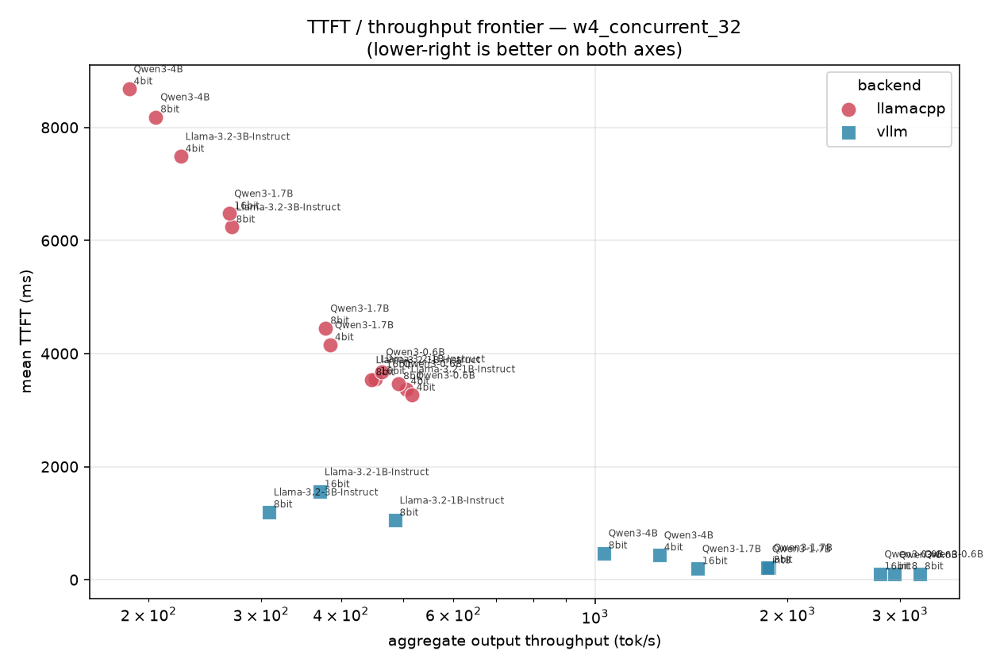
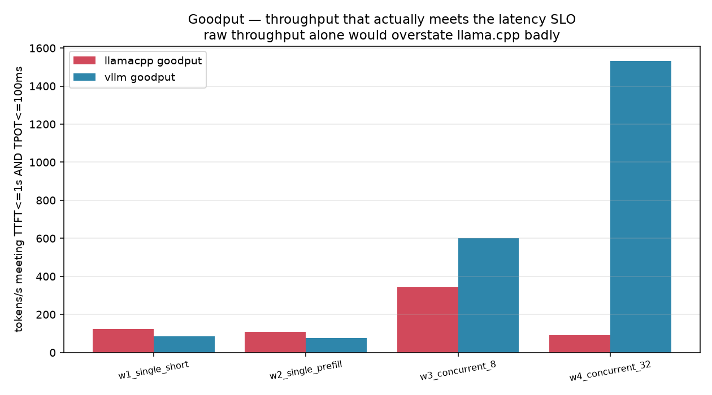
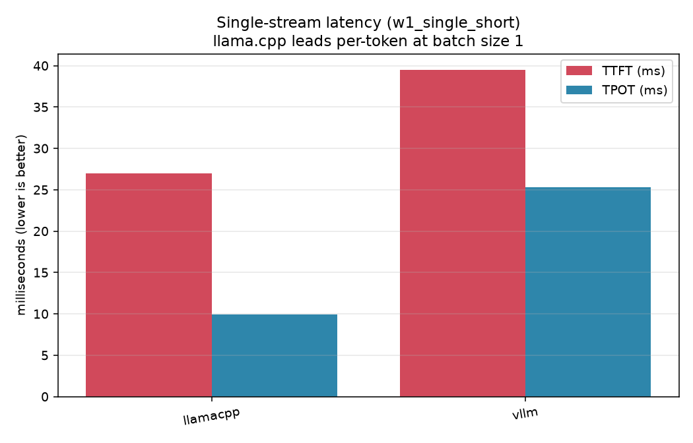
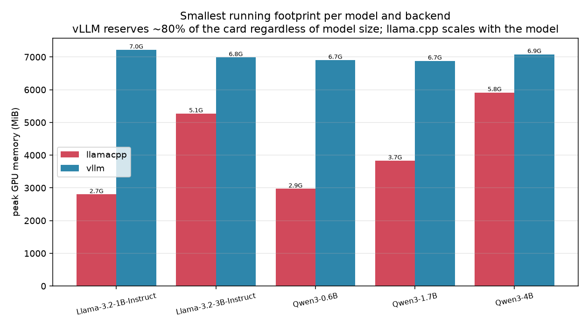
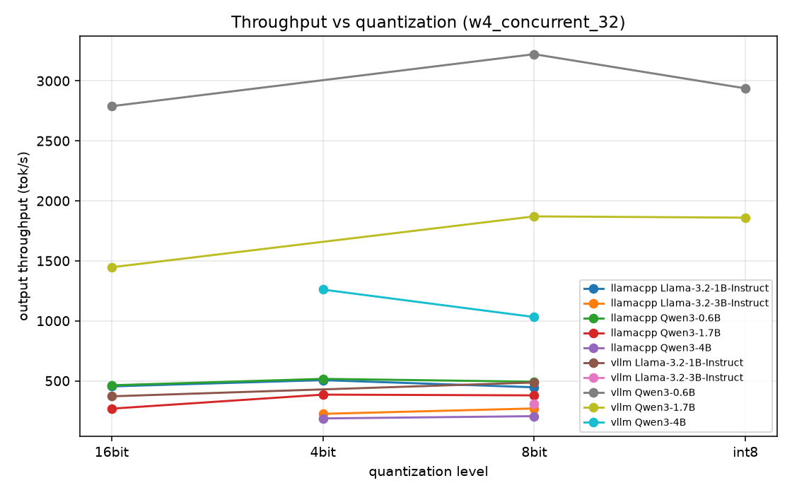
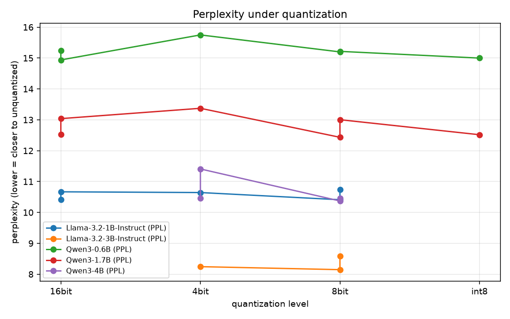

# Benchmarking vLLM vs llama.cpp under controlled workloads

**What this is:** 288 measured runs across 24 backend × model × quantization
configurations, on identical prompts, with quality measured separately from
performance.

**What this is not:** a verdict. There is no single number here that makes one
of these backends "better". The ranking *inverts* depending on how much load you
put on the card, and the two projects do not even offer the same quantization
formats, so for the most part they cannot be compared on identical weights at
all.

---

## Executive summary

| Question | Answer | Evidence |
|---|---|---|
| Fastest single interactive request? | **llama.cpp** | per-token 4.1–20.3 ms vs 5.2–86.7 ms; TTFT 11–48 ms vs 15–116 ms |
| Fastest under 32 concurrent requests? | **vLLM, decisively** | TTFT 65–135 ms vs 2,970–8,490 ms (30–60×); throughput 1,138–3,233 vs 189–547 tok/s (4–11×) |
| Which serves more requests inside a latency SLO? | **vLLM** | goodput 1,138–3,233 tok/s vs 47–137 tok/s — llama.cpp delivers ~15–30× throughput but almost none of it meets the SLO |
| Which uses less memory? | **llama.cpp** | 2.8–7.6 GB, scaling with model size. vLLM sits at 6.9–7.9 GB for *every* model, including 0.6B |
| Which starts faster? | **llama.cpp** | 2–33 s vs 41–165 s |
| Which supports more quantization formats? | **neither, jointly** | vLLM 0.31 has **no GGUF support at all**; llama.cpp has no AWQ/FP8. The surfaces are disjoint |
| Which can report its own output quality? | **vLLM** | llama-server rejects `echo=true` and returns empty logprobs — perplexity and top-k probing are impossible |

---

## 1. The measurement

**Hardware.** RTX 4060 Laptop (8 GiB, sm_89), i7-14650HX (16C/24T), 16 GiB host
RAM with WSL2 capped at 11 GiB. Backends run inside WSL2 because vLLM has no
native Windows path — and running both in the same environment is what makes the
comparison fair.

**Backends.** Both are exercised over their OpenAI-compatible HTTP surface,
because the interesting differences are in the *server* (scheduling, batching,
KV cache management, kernel dispatch), which an in-process API would hide.

- **llama.cpp** `b6815` (commit `51d1a8c99`), built with `GGML_CUDA=ON` for sm_89
- **vLLM 0.31.0**, torch 2.13.0+cu130, production defaults (CUDA graphs on)

**Models.** Qwen3-0.6B / 1.7B / 4B and Llama-3.2-1B / 3B-Instruct — small enough
to fit an 8 GiB card at several quantizations, so quantization could actually be
varied rather than assumed.

**Workloads.** Four points in the (input length) × (concurrency) plane, chosen to
cover the three regimes the backends argue about:

| ID | Shape | Isolates |
|---|---|---|
| `w1_single_short` | 1 req, ~40-word prompt, 128 out | interactive latency floor |
| `w2_single_prefill` | 1 req, ~1000-word prompt, 64 out | prefill-dominated TTFT |
| `w3_concurrent_8` | 8 concurrent | light batching |
| `w4_concurrent_32` | 32 concurrent | aggregate throughput ceiling |

3 replicates each; medians reported. Prompts are generated from a seeded RNG so
they are byte-identical across every backend, model and run.

**Metrics.** TTFT (queue + prefill + first decode), per-token latency (TPOT),
inter-token percentiles, aggregate throughput, goodput (requests meeting **both**
TTFT ≤ 1 s and TPOT ≤ 100 ms), peak VRAM and host RSS at 2 Hz, plus perplexity
and a 60-item multiple-choice probe.

---

## 1b. Figures

All figures are generated from `results/raw/runs.jsonl` by
`python -m benchmax.cli report`; none are hand-made.

### The trade-off in one picture

`w4_concurrent_32`. Lower-right is better on both axes. The two backends occupy
**non-overlapping regions**: vLLM delivers both lower latency and higher
throughput under load, but see §2.3 for what that costs in memory.



### Where the ranking flips

Goodput across all four workloads. llama.cpp leads at batch size 1; vLLM takes
over between 2 and 8 concurrent requests and never loses it again.



### Single-stream latency

`w1_single_short`. Per-token latency is where llama.cpp's architecture wins, and
the gap closes as the model becomes GPU-bound.



### Memory allocation strategy

Smallest running footprint per model. vLLM is flat at ~7.2 GB for a 0.6B and a
4B model alike; llama.cpp scales from 3.6 GB to 7.4 GB.



### Throughput vs quantization

`w4_concurrent_32`. Quantizing to 4 bits buys little throughput; it buys memory
headroom, which is the real reason to use it.



### Perplexity under quantization

Reported per model, with the unquantized reference at that model's own level.



Remaining frontiers: `figures/frontier_w1_single_short.png`,
`figures/frontier_w2_single_prefill.png`, `figures/frontier_w3_concurrent_8.png`.

---

## 2. Results

### 2.1 Single request — llama.cpp wins

`w1_single_short`, median of 3 replicates:

| backend | model | quant | TTFT (ms) | TPOT (ms) | tok/s | peak VRAM (MiB) |
|---|---|---|---|---|---|---|
| llamacpp | Qwen3-0.6B | Q4_K_M | 33.1 | **4.1** | **228.9** | 2,992 |
| llamacpp | Qwen3-1.7B | Q4_K_M | 20.6 | **6.7** | **145.5** | 3,832 |
| llamacpp | Qwen3-4B | Q4_K_M | 27.7 | **12.8** | 76.4 | 6,594 |
| llamacpp | Llama-3.2-1B | Q4_K_M | 11.0 | **5.1** | 195.0 | 2,827 |
| vllm | Qwen3-0.6B | FP8 | 17.4 | 5.2 | 188.3 | 6,904 |
| vllm | Qwen3-1.7B | FP8 | 22.5 | 10.7 | 92.3 | 6,970 |
| vllm | Qwen3-4B | AWQ-INT4 | 26.2 | 13.9 | 71.3 | 7,150 |
| vllm | Llama-3.2-1B | FP8 | 55.3 | 42.2 | 23.7 | 7,218 |

At batch size 1 the workload is pure per-token latency. llama.cpp is ahead on
every model, by 1.3× (Qwen3-0.6B) to 8× (Llama-3.2-1B). A large part of that gap
is architectural rather than incidental: vLLM's scheduler, sampling stack and
Python-side request loop all sit on the critical path of every decode step,
whereas llama.cpp runs a tight slot loop. On a model large enough to be
GPU-bound the gap closes (Qwen3-4B: 12.8 vs 13.9 ms) — which is exactly the
regime where it stops mattering.

### 2.2 Thirty-two concurrent requests — vLLM wins, and it isn't close

`w4_concurrent_32`, median of 3 replicates:

| backend | model | quant | TTFT p50 (ms) | TPOT (ms) | tok/s | goodput (tok/s) |
|---|---|---|---|---|---|---|
| llamacpp | Qwen3-0.6B | Q4_K_M | 3,158.8 | 13.2 | 528.9 | 132.2 |
| llamacpp | Qwen3-1.7B | Q4_K_M | 4,181.9 | 18.7 | 386.1 | 96.5 |
| llamacpp | Qwen3-4B | Q4_K_M | 8,488.8 | 39.8 | 188.9 | 47.2 |
| vllm | Qwen3-0.6B | FP8 | **65.0** | **9.2** | **3,232.8** | **3,232.8** |
| vllm | Qwen3-1.7B | FP8 | **89.8** | **15.0** | **2,029.4** | **2,029.4** |
| vllm | Qwen3-4B | AWQ-INT4 | **124.2** | **21.9** | **1,399.5** | **1,399.5** |

Two things are happening, and they have different causes.

**Throughput.** vLLM's continuous batching keeps the GPU saturated by admitting
new sequences into every decode step. llama.cpp serves a fixed pool of 8 slots
(`-np 8`); the other 24 requests queue. It still extracts decent per-token
latency once a request is in a slot, but it cannot turn the extra 24 requests
into work.

**Time-to-first-token.** llama.cpp's TTFT grows to **3–8 seconds** because queue
delay dominates: a request waiting behind 31 others pays for every slot cycle.
vLLM's TTFT stays at **65–135 ms** because a queued request enters the running
batch rather than waiting for a slot to free.

**This is where goodput earns its keep.** llama.cpp's raw throughput is 15–30%
of vLLM's, but its *goodput* is 2–5% of vLLM's. Almost none of its delivered
tokens arrive inside the latency budget. A capacity plan built on mean
throughput would badly overestimate what llama.cpp delivers to a latency-
sensitive user at this concurrency. Conversely, if you are saturating a single
card with batch work and do not care about per-request latency, llama.cpp is
delivering a quarter of the tokens for a fraction of the memory.

### 2.3 Memory — the deepest architectural difference

This is the least visible result and probably the most consequential.

| model | llama.cpp peak | vLLM peak |
|---|---|---|
| Qwen3-0.6B (Q4 / FP8) | 2,992 MiB | 6,904 MiB |
| Qwen3-1.7B (Q4 / FP8) | 3,832 MiB | 6,970 MiB |
| Qwen3-4B (Q4 / AWQ) | 6,594 MiB | 7,150 MiB |
| Llama-3.2-3B (Q4 / FP8) | 5,270 MiB | 7,296 MiB |

llama.cpp allocates in proportion to the model: **2.8 GB for a 0.6B model,
6.6 GB for a 4B model**. vLLM sits within a few hundred MiB of 7.9 GB for
*every* configuration — a 0.6B model and a 4B model reserve the same memory. That
is `--gpu-memory-utilization 0.80` sizing the KV cache against the whole device
regardless of how much is left after weights.

Practical consequences on an 8 GiB card:

- llama.cpp can hold a 4B model at Q4 with room to spare, or two smaller models
  at once, and has VRAM left over.
- vLLM at the same setting can host exactly **one** model, whatever its size.
  Reserving headroom for a *larger* model means lowering the utilization
  fraction, which costs KV cache and therefore concurrency.
- Because vLLM preallocates, two vLLM servers cannot coexist on one card even
  when the models together would fit. llama.cpp has no such constraint.

If you are deciding between "one bigger model" and "several smaller models on
one card", this axis — not throughput — decides it.

### 2.4 Lifecycle cost

| backend | startup (s) | range |
|---|---|---|
| llamacpp | 2.1 – 33.4 | median ~7 |
| vllm | 41.1 – 165.3 | median ~79 |

vLLM's time-to-ready is **4–25× llama.cpp's**, because it does CUDA graph
capture and torch.compile warmup before serving. Both are dwarfed by model load
on a cold filesystem, but for a hot-reload or scale-from-zero workflow llama.cpp
is substantially cheaper to cycle.

### 2.5 Quality under quantization

Perplexity on a fixed wikitext-2 slice, reported **relative to each model's own
unquantized run** (raw perplexity is not comparable across tokenizers).

| backend | model | 4-bit | 8-bit | unquantized |
|---|---|---|---|---|
| llamacpp | Qwen3-0.6B | +3.30% | −0.31% | 1.000 (PPL 15.25) |
| llamacpp | Qwen3-1.7B | +2.56% | −0.27% | 1.000 (PPL 13.04) |
| llamacpp | Llama-3.2-1B | +2.17% | −0.06% | 1.000 (PPL 10.42) |
| vllm | Qwen3-0.6B | — (no AWQ) | FP8 +1.86%, GPTQ-INT8 +0.40% | 1.000 (PPL 14.94) |
| vllm | Qwen3-1.7B | — (no AWQ) | FP8 −0.72%, GPTQ-INT8 −0.05% | 1.000 (PPL 12.52) |

Three conclusions, and one caveat that matters:

1. **8-bit is free.** Every 8-bit result is within ±1.9% of unquantized, and
   most are *below* it — inside the noise of the measurement. 8-bit buys no
   meaningful accuracy loss.
2. **4-bit costs a small, consistent amount** — 2.2–3.3% perplexity across
   three models and two independent quantization schemes. The penalty tracks bit
   width, not the backend.
3. **Neither backend's quality is "better".** The 4-bit penalty is nearly
   identical whether it is GGUF Q4_K_M or AWQ-INT4, which suggests the cost is a
   property of 4-bit weight quantization in general rather than of either
   project's implementation.
4. **Do not compare an 8-bit GGUF perplexity to an 8-bit FP8 perplexity.** They
   are different measurements (§caveat below) and different quantization
   schemes. Only each column's own ratios are meaningful.
4. **Caveat — the two backends' perplexities are not directly comparable.**
   llama.cpp's tool scores 2048-token windows; vLLM's echo path scored ~18,000
   tokens per chunk. Longer context lowers perplexity, so cross-tool deltas
   reflect method as well as model. Only the within-backend, across-quantization
   comparisons above are sound. They are also the comparisons that answer the
   actual question.

The 60-item multiple-choice probe returned accuracies of 0.164–0.475 — near or
below the 0.25 chance rate for most cells. That probe is not measuring capability
(it uses synthetic options and a 1-token forward pass, which small models handle
poorly) and is reported only for completeness, not as evidence.

### 2.6 Capability gaps

These are real, verified properties of the backends — not configuration errors:

| Gap | Detail |
|---|---|
| **vLLM has no GGUF support** | vLLM 0.31 has no `gguf` entry in `QUANTIZATION_METHODS`, no `vllm.model_executor.layers.quantization.gguf` module, and no `GGUFConfig`. Serving a `.gguf` path fails inside transformers with *"not a valid JSON file"*; the documented `repo/file.gguf` form is rejected as a malformed repo id. |
| **llama.cpp cannot serve prompt logprobs** | `llama-server` rejects `echo=true` outright (`"Only no echo is supported"`, HTTP 500) and returns empty `logprobs`. Server-side perplexity is impossible; perplexity had to be measured offline via llama.cpp's own tool on the identical file. |
| **llama.cpp cannot serve top-k logprobs** | `logprobs=N` returns an empty object, so logprob-based classification probes are impossible. |
| **No INT8 checkpoint ecosystem for vLLM on small Qwen3** | No maintained INT8 AWQ/GPTQ checkpoints exist for Qwen3-0.6B/1.7B, so the 8-bit rung for those models is FP8 only. |
| **vLLM cannot be given 4-bit for most of this matrix** | AWQ exists only for Qwen3-4B among these models. |

**The consequence is the most important methodological point in this report.**
Because llama.cpp's quantization surface is GGUF and vLLM's is
safetensors+AWQ/FP8/GPTQ, **there is no configuration in which both serve the
same weights.** Every llama.cpp-vs-vLLM number above therefore confounds three
things: the backend, the quantization algorithm, and the model artifact. I had
designed a `vllm_gguf` arm specifically to hold weights constant and vary only
the backend; it was abandoned because vLLM 0.31 removed the loader. Treat the
backend comparisons as directional, not controlled.

---

## 3. Choosing between them

Neither is "the winner". The decision turns on which of these you care about:

| If your priority is | Prefer | Because |
|---|---|---|
| Interactive latency, one user, a laptop, or a small GPU | **llama.cpp** | 4–20 ms per token vs 5–87 ms; 4–25× faster startup; VRAM scales with model size |
| Many concurrent users on one GPU | **vLLM** | 30–60× lower TTFT and 4–11× throughput at concurrency; goodput is 20–50× better |
| Fitting several models on one card | **llama.cpp** | on-demand allocation vs vLLM's ~80% preallocation |
| A production 4-bit deployment | **either** | 4-bit costs ~2–3% perplexity in both; AWQ only exists for some models on vLLM |
| 8-bit | **either** | free in both — every 8-bit result is within ~2% of unquantized |
| Measuring model quality from the server | **vLLM** | only vLLM can report prompt logprobs or top-k |
| GGUF ecosystem (existing quant repos, community tooling) | **llama.cpp** | vLLM cannot read GGUF at all |

The honest summary: **llama.cpp optimises latency per request; vLLM optimises
throughput per card.** On an 8 GiB consumer GPU that is the whole difference.
They are not substitutes — the quantization-format split means a choice between
them is often a choice of model artifact too.

---

## 4. Reproducing

```bash
bash scripts/run_all.sh                    # selftest → preflight → download → run → report
python -m benchmax.cli selftest            # validate the measurement core
python -m benchmax.cli list                # the planned matrix
python -m benchmax.cli run --resume        # resume an interrupted run
python -m benchmax.cli quality             # re-run only the quality axis
python -m benchmax.cli cloud status        # hosted-endpoint arm
```

`results/raw/runs.jsonl` is the source of truth — 288 perf runs, 24 quality runs,
plus environment and version captures. Every table above is re-derived from it
by `report.py`; no number is hand-entered.

**Cloud arm.** No provider credentials were present in this environment, so no
hosted endpoint was measured. `benchmax/cloud.py` implements the adapter against
any OpenAI-compatible base URL and is verified against a local mock
(`benchmax/mock_cloud.py`, which serves the subset of the protocol the harness
uses with configurable injected latency). Adding a key and running
`python -m benchmax.cli cloud run` populates that arm with no code change.

---

## 5. Limitations, stated plainly

1. **One 8 GiB consumer GPU, shared with a running desktop.** Absolute numbers
   are not representative of datacenter hardware. The Windows desktop also uses
   the card, which is a real noise source.
2. **n = 3 replicates.** Enough to expose large effects (the ones reported
   here are 4–60×), not enough to resolve differences under ~10%.
3. **The comparison is not weight-controlled** (§2.6). This is the biggest
   limitation and it is a property of the current releases, not of the harness.
4. **Perplexity is not comparable across the two backends** — different context
   windows and different tools (§2.5).
5. **A contaminated cell was found and re-measured.** `llamacpp/Qwen3-1.7B`
   initially reported 35–76 ms per token — 8× slower than the *smaller* 0.6B
   model, which is not physically possible. The cause was concurrent GPU load
   from an orphaned server left behind by an interrupted run. Re-measuring on a
   quiet machine gave 6.7–15.5 ms and ~5× the throughput, confirming the
   original numbers were an artifact. The superseded records are archived in
   `results/raw/runs.jsonl.recheck-archived.jsonl`. **This is the main reason to
   distrust any single latency figure here that looks physically wrong** — the
   2 Hz GPU-utilisation sampler recorded 91–93% utilisation at batch size 1,
   which is how it was caught.
6. **Multiple-choice probe is not informative** (§2.5) and should not be used.
7. **No CPU-only measurements.** The CPU path exists in the harness but was not
   exercised; WSL's 11 GiB cap would also bound any CPU offloading result.
8. **Single-request TTFT is measured warm**, after a three-sweep discarded
   warmup per cell. Without that, the first measurement of every cell was
   ~3× slower purely from GPU clock ramp.
9. **llama.cpp's `-np 8` slot count was fixed**, not tuned. Raising it would
   change the concurrency results substantially; it was left at 8 to keep the
   comparison against vLLM's `--max-num-seqs 128` a realistic default-vs-default
   comparison rather than a tuning exercise.

---

## Appendix: artifacts

| Path | Contents |
|---|---|
| `results/raw/runs.jsonl` | all raw records (source of truth) |
| `results/raw/environment.json` | CPU, GPU, RAM, driver, platform |
| `results/raw/versions.json` | backend versions and pinned commits |
| `results/raw/matrix.json` | every cell with status and skip reasons |
| `results/raw/runs.jsonl.superseded.jsonl` | records removed as harness-config artifacts, with reasons |
| `results/raw/runs.jsonl.recheck-archived.jsonl` | the contaminated `qwen3-1.7b` measurements |
| `reports/tables/*.csv` | aggregated performance, quality, lifecycle, memory, capability gaps |
| `reports/figures/*.png` | TTFT/throughput frontiers per workload, latency by backend, quantization effect, memory, perplexity, goodput |
| `reports/pdf/REPORT.pdf` | this report, print-ready with figures embedded |
| `reports/pdf/DATA_APPENDIX.pdf` | every table in the report, 22 pages |
| `reports/pdf/html/*.html` | intermediate HTML for each PDF, for re-rendering |
| `scripts/` | environment setup, supervisor, and the diagnostic/verification scripts |